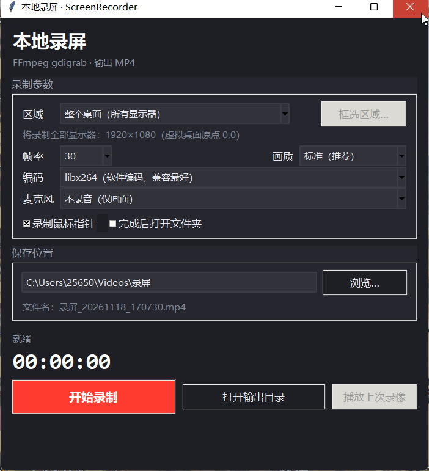

# ScreenRecorder · Windows 本地录屏

把当前屏幕（整屏 / 指定区域）录成标准 **MP4**：H.264 + AAC，`+faststart` 索引前置，网页和手机都能直接播放。

界面基于 Tkinter 深色主题，录制内核是 FFmpeg 的 `gdigrab`。**零第三方 Python 依赖**，打包后双击即用 —— 不需要装 Python，也不需要另外装 FFmpeg。



## 特性

| 能力 | 说明 |
| --- | --- |
| 录制范围 | 整个桌面（含多显示器）/ 主显示器 / 自定义区域（框选时全屏半透明遮罩 + 拖拽，Esc 取消） |
| 帧率 | 15 / 24 / 30 / 60，默认 30 |
| 画质 | 高质量 CRF18 / 标准 CRF20 / 较小 CRF24 / 最小 CRF28 |
| 编码 | `libx264` 软件编码，或 `h264_qsv` / `h264_nvenc` / `h264_amf` 硬件编码 |
| 音频 | 可选麦克风，AAC 48kHz 立体声 160kbps，与画面合成单条音轨 |
| 鼠标 | 可选择是否把光标画进视频 |
| 停止收尾 | 向 FFmpeg stdin 写 `q` 让 `moov` 正常落盘，不会留下打不开的残片 |
| 帧率稳定 | 视频输入加 `-thread_queue_size 512`，采集掉帧自动补帧，时长精确 |
| DPI 对齐 | `SetProcessDpiAwareness(2)`，125% / 150% 缩放下框选区域与采集像素一致（实测 SSIM 0.999996） |
| 录制时不挡屏 | 主窗口收成右下角小控制条，置顶但只占 400×185 |

## 快速开始

### 方式一：免安装包（推荐，不需要 Python）

完整包 38.3 MB（40,140,660 字节），因为超出了 GitHub 单次上传体积限制，被切成 7 片放在 [release/](release/) 目录：

1. 下载 `release/part-01` ~ `release/part-07`（7 个文件，共约 38 MB）
2. 双击 `release/合并.bat` 自动合并并打印 SHA256；Linux / macOS 用 `cat part-* > ../ScreenRecorder-win64-portable.zip`
3. 校验 SHA256 是否为 `28e8639d7cb836e43418bc7437c7d2ec2f6308da7e05ed1cc18836451bac2bfa`
4. 解压得到的 `ScreenRecorder-win64-portable.zip`，双击里面的 `ScreenRecorder.exe`

详见 [release/README.md](release/README.md)。

也可以按 [docs/BUILD.md](docs/BUILD.md) 自己打包，两条命令就能得到同样的产物。

> 整个 `ScreenRecorder` 文件夹（约 102 MB）要一起复制或移动，只拿 `ScreenRecorder.exe` 单独跑会因缺运行时启动失败。

### 方式二：从源码运行

```bat
git clone https://github.com/duxinyan666/ScreenRecorder.git
cd ScreenRecorder
python screen_recorder.py
```

或者双击 `启动录屏.bat`（自动挑选 `pythonw.exe`，不弹黑框）。

从源码运行需要本机有 FFmpeg：程序按「`--ffmpeg` 参数 → `SCREEN_RECORDER_FFMPEG` 环境变量 → 程序目录 → PATH → WinGet / 常见安装路径」的顺序查找，找到后会在界面标题下方显示版本号。最快的方式是把 `ffmpeg.exe` 直接放到脚本同目录。

### 录一段

点「开始录制」→ 3 秒倒计时 → 窗口自动收成右下角小控制条 → 点「停止录制」或按 `Esc` → 自动封装 MP4。

默认保存到 `%USERPROFILE%\Videos\录屏`，文件名形如 `录屏_20261118_170730.mp4`。

## 命令行

不用界面也能录，适合脚本、批处理、定时任务：

```bat
python screen_recorder.py --cli --duration 10 -o demo.mp4
python screen_recorder.py --cli --region 100,100,800,600 -o area.mp4
python screen_recorder.py --cli --audio "麦克风阵列 (适用于数字麦克风的英特尔® 智音技术)" -o voice.mp4
python screen_recorder.py --cli --encoder h264_qsv --fps 60 -o game.mp4
python screen_recorder.py --list-devices
python screen_recorder.py --list-screens
```

| 参数 | 说明 |
| --- | --- |
| `--cli` | 命令行录制，不打开界面 |
| `-o, --output` | 输出路径（自动补 `.mp4`） |
| `--fps` | 帧率，15 / 24 / 30 / 60 |
| `--region` | 区域 `x,y,宽,高`，物理像素，虚拟桌面坐标 |
| `--audio` | 麦克风设备名，省略则不录音 |
| `--encoder` | `libx264` / `h264_qsv` / `h264_nvenc` / `h264_amf` |
| `--crf` | 画质 18（高）～ 28（小体积），默认 20 |
| `--duration` | 最长录制秒数，省略则等 Ctrl+C |
| `--no-mouse` | 不录制鼠标指针 |
| `--list-devices` | 列出麦克风设备与编码器真实可用性 |
| `--list-screens` | 列出显示器与虚拟桌面几何 |
| `--ffmpeg` | 指定 `ffmpeg.exe` 路径 |
| `--smoke` | 只构建界面并退出（自检） |

## 输出规格

- 容器：MP4，`-movflags +faststart`
- 视频：H.264，`yuv420p`，恒定帧率，`-g fps*2`
- 音频（可选）：AAC，48 kHz，立体声，160 kbps

实测（1920×1080、125% 缩放、Intel Iris Xe）：

| 场景 | 结果 |
| --- | --- |
| 全屏 1080p30 录 5 秒 | 150 帧，0.43 MB，时长 00:05 |
| 区域 800×600 + 麦克风 | 800×600 / 30fps / 含 AAC 音轨，时长精确 |
| `h264_qsv` 硬件编码 3 秒 | 0.36 MB |
| 区域坐标精度 | 录 `0,0,400,400` 与全屏帧裁剪同区域对比，SSIM = 0.999996 |
| 免安装包启动 | 首次约 2.9 s（含 Defender 扫描），之后约 1.4 s |
| 免安装包录制 | 1920×1080 / 30fps / 时长 2.97 s / 0.63 MB |

## 目录结构

```
screen_recorder.py                    主程序：界面 + 录制内核 + 命令行
启动录屏.bat                          双击启动（自动挑选 pythonw）
requirements.txt                      空的，只为表明无需依赖
app.ico                               程序图标
release/part-01 … part-07             免安装包分片（exe + 运行时 + 内置 ffmpeg）
release/合并.bat                      分片合并脚本（带 SHA256 校验）
release/README.md                     分片说明
docs/USAGE.md                         完整使用手册、参数详解、故障排查
docs/BUILD.md                         打包成免安装 exe 的步骤与实测对比
docs/images/main-window.png           界面截图
```

## 实现要点

- **DPI 对齐**：启动即 `SetProcessDpiAwareness(2)`，Tk 与 `gdigrab` 共用物理像素坐标，高缩放下框选不会偏移。
- **停止收尾**：`q` 写入 FFmpeg stdin → 正常写完 `moov`；超时才 terminate，最后由 `ffprobe` 校验产物，失败会明确提示。
- **实时进度**：FFmpeg 用 `\r` 刷新同一行，日志线程改用 `read1(4096)` 并按 `\r` / `\n` 双分隔切分，计时与 fps 才是实时的。
- **防掉帧**：带麦克风时 DirectShow 读取会阻塞采集，加 `-thread_queue_size 512` 后从约 19fps 恢复到稳 30fps。
- **编码器探测**：不看 `-encoders` 列表下结论，真实跑一次 lavfi 编码测试，跑不过就不在界面里出现。
- **界面细节**：ttk `clam` 主题下 `readonly` 状态 Combobox 必须做 `map` 配色映射，否则中文行高被裁、底色发白。
- **窗口收成控制条**：`minsize(660,640)` 会让 `geometry(400x185)` 失效，compact 时临时 `minsize(1,1)`，恢复时还原。

## 已知限制

- 独占全屏的游戏、部分远程桌面会话、受 DRM 保护的播放器无法被 GDI 采集，会录成黑屏。把游戏改成「无边框窗口」模式即可。
- `gdigrab` 的偏移量受虚拟桌面原点限制，副屏在主屏左侧/上方（坐标为负）时，自定义框选只覆盖主屏范围。
- 4K 高刷屏 + 软件编码容易撞 CPU 瓶颈，建议切硬件编码或把帧率降到 30。

更多细节见 [docs/USAGE.md](docs/USAGE.md)。

## 许可证

[MIT](LICENSE)
